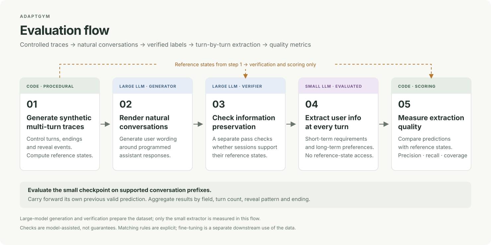
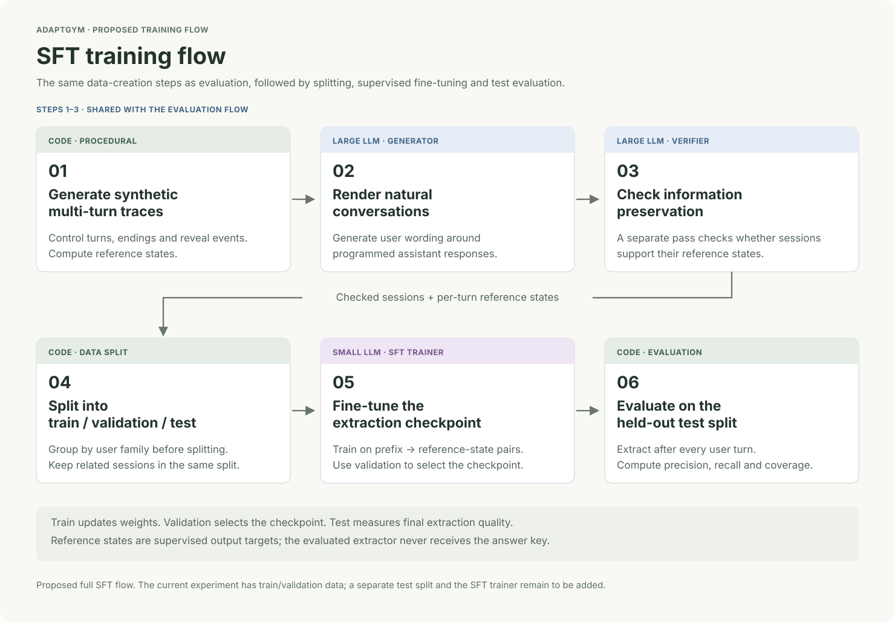
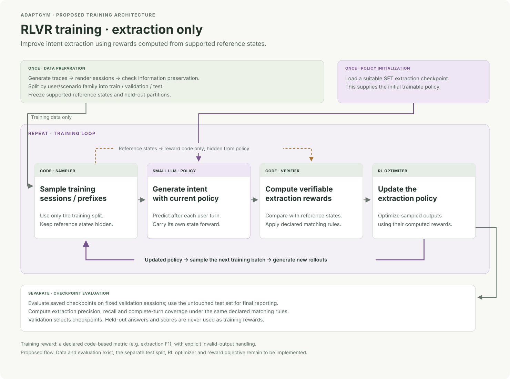
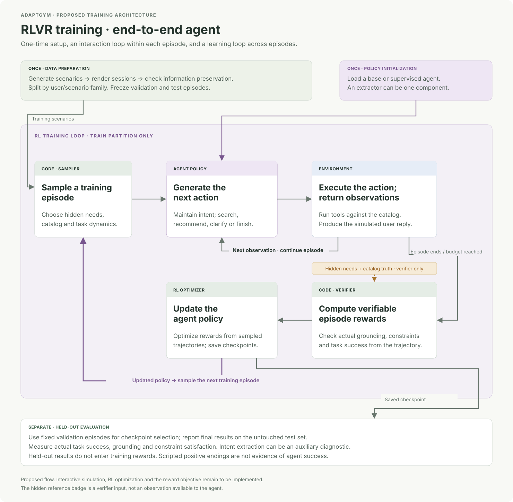

# AdaptGym: controlled conversations for evaluating adaptation

**Live demo:** [AdaptGym](https://adaptgym.onrender.com/) — live LLM calls use shared API quota; please keep requests modest.

Similar work in the legal domain: [Engram: Understanding a Law Firm through Study](https://engram.com/blog/legal-agents-with-memory).

A recommendation agent can understand the first request and still lose track of the user when a budget changes, another requirement arrives, or a reply refers to an earlier recommendation. A useful test must check what the agent retains, revises and discards throughout the conversation.

AdaptGym creates controlled synthetic conversations with an explicit reference state after every user turn. Code specifies the intended changes; an LLM renders them naturally; a separate verification pass checks that the wording supports the labels. The extraction checkpoint then reconstructs the user’s current requirements and longer-term preferences from the visible conversation.

**Control what changes. Measure what the model remembers.** These conversation–target pairs support detailed extraction evaluation and can provide supervision for fine-tuning.

The current implementation tests structured intent extraction with programmed assistant actions. Training loops and evaluation of a live recommendation policy are proposed extensions toward a broader configurable RL environment.

**What is an RL environment?**

An RL environment creates tasks and interactions, lets an agent act, and provides feedback or rewards on the outcomes. The same environment can generate training experience and measure whether the agent improves. AdaptGym’s current implementation provides the synthetic conversations, reference states and extraction evaluation that form the foundation for this broader goal.

**Why an RL environment?**

Reinforcement learning is a key component of frontier model training: models practice tasks and learn from graded outcomes before deployment. [Anthropic describes this training setup, alongside the risks of optimizing an imperfect reward](https://alignment.anthropic.com/2026/reward-seeker/).

In our case, AdaptGym will generate synthetic conversations with evolving preferences, changing constraints, and shifting goals. It will train and evaluate agents on their ability to retain relevant information, revise outdated assumptions, and apply the right context—helping them adapt to users’ needs before deployment.

The first application is conversational product recommendation. A shopper may state a requirement directly, express a preference through past choices, revise a budget, or respond to a recommendation with “yes,” “lower,” or “the second one.” Understanding these interactions requires more than extracting attributes from the latest message. The agent must combine evidence across the conversation, resolve references to assistant responses, and distinguish durable preferences from requirements that apply only to the current purchase.

AdaptGym will support two complementary training objectives:

- **Supervised extraction:** train a model that provides structured intent as features to another agent.
- **Adaptation within the recommendation agent:** train an agent to maintain intent as part of its own capabilities and use that state to choose recommendations, questions, and other actions.

Both objectives use the same underlying conversations and per-turn intent targets. Their evaluation differs: extraction is measured by faithful interpretation, while the integrated agent must also be measured by the usefulness of its subsequent decisions.

## What the tests reveal

- **Retention:** keep earlier requirements active while other information arrives.
- **Revision:** replace outdated values or withdraw constraints without losing unrelated information.
- **Reference resolution:** interpret a reply using the assistant question or recommendation list it refers to.
- **Task boundaries:** recognize a new or completed search and retire task-specific requirements.
- **Scope and strength:** distinguish a current mandatory requirement from a longer-term preference.

Vary conversation length, disclosure timing and event combinations to isolate these behaviors. A correct final answer alone can conceal errors and recovery at intermediary turns.

## Stage 1: Evaluation — the five-step approach

1. **Generate synthetic sessions procedurally.** Build multi-turn user–assistant traces with controlled events and known reference states.
2. **Render natural conversations with a large LLM.** Use a larger, slower model to express the planned user events naturally around programmed assistant responses.
3. **Check information preservation with a large LLM.** Run a separate verification pass to check that the conversation supports its reference states.
4. **Extract user information with the small LLM being evaluated.** Recover short-term requirements and longer-term preferences after each user turn, without access to the reference states.
5. **Compute extraction quality metrics.** Compare predictions with the reference states to measure precision, recall and complete-turn coverage.

The large model prepares and checks the dataset; the small model is the checkpoint being measured. The reference states come from step 1 and are used in steps 3 and 5. The resulting conversation–target pairs can also provide supervision for fine-tuning.

AdaptGym starts with a controlled trace of how user intent changes. It then generates a conversation that expresses that trace, checks the information survived, and evaluates whether an extraction model can recover it.

### 1. Procedurally generate synthetic intent traces

Code specifies what the user reveals and when. It samples initial needs, schedules changes, programs assistant actions, and computes the expected state after every user turn.

This gives us control over the data distribution:

- **Conversation length:** how many turns a session contains.
- **Ending balance:** how many sessions end in scripted success, failure or an unresolved outcome.
- **Reveal patterns:** which attributes appear initially and which arrive later.
- **Event combinations:** additions, revisions, retractions, clarifications, task changes and reactions to recommendations.
- **Interpretation difficulty:** direct statements, implicit evidence and replies that depend on assistant context.

These controls let us construct targeted tests and training curricula. For example, we can increase the proportion of conversations that introduce a new requirement late, or revisit an earlier preference after several intervening turns.

Success and failure here describe **planned scenario endings**. They do not measure the performance of a live recommendation policy.

### 2. Use an LLM to turn traces into natural-looking sessions

The generator receives the persona, current scenario instruction and available conversational context. It turns the planned user event into natural language. Assistant questions, recommendations and other actions are currently programmed.

The procedural trace provides the intended meaning; the LLM provides its wording. This allows linguistic variation while keeping the underlying changes inspectable.

For example, the trace might introduce a maximum budget, then lower it, then refer to the second item in a displayed recommendation list. Each generated message must express the event intended for that turn without revealing future events.

### 3. Use a separate LLM pass to check information preservation

Procedural labels are only useful if the generated conversation supports them. A separate verifier receives the visible conversation and candidate labels, without the scenario instructions.

It checks whether required information is present, whether values or comparison operators changed, whether preferences became mandatory constraints, and whether the conversation establishes the intended task state and outcome. Evidence references connect judgments to specific messages.

If the trace specifies a hard €150 maximum but the generated user says “around €150, though I can stretch,” the wording has changed the constraint. That example needs review or a generation retry. A dataset-generation pipeline can retry that turn or reuse a previously verified conversation prefix.

This is a model-assisted quality check, not a guarantee. Generation and verification can share biases, particularly when they use the same model family.

### 4. Extract short-term and long-term user information at every turn

The extraction checkpoint reads the conversation prefix and updates a structured representation of the user’s current intent:

- **Short-term information:** requirements associated with the current task or search.
- **Long-term information:** general preferences that may remain relevant after that task finishes.

This is schema-defined intent information, rather than an unrestricted personal profile. General background belongs in the persona; product or job preferences reference attributes defined by the environment.

The evaluation design distinguishes two modes:

- **Accumulated state:** each turn receives the model’s own previous valid prediction. Errors can accumulate, and later turns can show recovery.
- **Previous correct state:** each turn starts from the reference state after the previous turn. This isolates the current update from earlier model errors.

Both modes receive the conversation prefix and start the first turn without a previous state. The current turn’s reference state remains hidden from the extractor. Results must identify the mode: starting from a correct previous state is an oracle-conditioned diagnostic, rather than a measurement of fully accumulated behavior. The existing baseline results used accumulated state. The session lab supports both modes through its Previous-state input selector.

### 5. Compute extraction precision, recall and coverage

Compare extracted information with the reference state after **every user message**, including intermediary turns.

- **Precision:** how much of the returned information matches the reference?
- **Recall:** how much of the expected information was recovered?
- **Complete-turn coverage:** were all expected values recovered at this turn?

Breakdowns by attribute, conversation length, ending and interaction type help identify where a checkpoint fails. Examples and error classifications distinguish missing fields, partially recovered value sets, unmatched values and invalid outputs.

Matching rules must explicitly define **what counts as a correct extraction**:

- **Capitalization:** must strings match exactly, or is matching case-insensitive?
- **Values inside arrays:** does a returned array count as correct when it contains the expected value?
- **Additional values:** for a multi-valued attribute, are extra alternatives allowed once every expected value is present, or must the returned set match exactly?
- **Additional attributes:** do fields absent from the reference affect complete-turn coverage?
- **Scope, strength and comparison operators:** must these also match, or is the headline score based only on values, with metadata differences reported separately?

The current value-focused baseline uses case-insensitive matching and accepts expected values inside returned arrays. Complete-turn coverage requires every expected value but tolerates additional values and attributes. Scope, strength and comparison operators are retained as separate diagnostics. Per-field precision still counts unsupported alternatives, even when those alternatives do not affect complete-turn coverage. Invalid outputs count as failures.

Report the matching policy alongside the evaluation mode, and keep both fixed when comparing checkpoints.

These metrics assess extraction under the declared matching rules; they do not by themselves measure recommendation quality or user satisfaction.

## What this enables

**Evaluate extraction checkpoints in depth.** Use the same controlled sessions and reference states to compare checkpoints, locate failure modes, and test whether a change improves retention, revision handling or reference resolution. Keep prompts, serving settings, data splits and scoring rules comparable when interpreting differences.

**Build supervision for fine-tuning.** Each supported conversation prefix has a corresponding target state. These pairs can train a model to update its understanding from new evidence. Keep user families separated between training and validation, and keep scenario instructions and current or future reference targets out of extractor inputs. In previous-correct-state mode, only the preceding reference state is supplied.

The current repository generates this data and evaluates prompted extractors. Connecting the examples to a fine-tuning trainer remains additional work.

## Three independent dimensions of a scenario

| Dimension | What it controls | Example |
| --- | --- | --- |
| **Expression** | Whether information is stated directly, conveyed indirectly through behavior or experience, or expressed through a mixture of both. | “I prefer lighter shoes” versus “The heavier pairs always stay in my cupboard.” |
| **Interaction dependence** | Whether a change is volunteered, is a self-contained reaction, or requires an assistant question or product list to interpret. | “My budget is €120” versus “The second one is too expensive.” |
| **Temporal scope** | Whether information belongs to the current task, is a durable preference, or has unresolved scope. | “For this search, I need on-site work” versus “I generally prefer remote work.” |

These dimensions can overlap. A context-dependent “yes” can explicitly confirm a proposition supplied by the assistant. An implicit preference can be durable. A temporary requirement can be expressed directly and revised over several turns.

Requirement strength is also represented: “must have” and “would prefer” should not automatically produce the same interpretation.

## A short example

| Turn | User information | Expected update |
| --- | --- | --- |
| 1 | “I generally prefer remote work.” | Record a durable, soft preference for remote work. |
| 2 | “For this search, I need an on-site role in Kyoto.” | Add the task-specific requirements; retain the general remote-work preference. |
| 3 | After seeing job options: “I’ll take the second role. It meets my needs; my search is complete.” | Record the selection and expressed success, close the task, and retain the general preference. |

The extractor must preserve information that was not repeated, distinguish a task-specific exception from a change in general preference, and resolve the selected job against the preceding assistant response.

## What an environment contains

An environment combines a schema and catalog with user backgrounds, scenario plans and evaluation artifacts.

| Component | Purpose |
| --- | --- |
| **Vertical schema and catalog** | Define allowed attributes, values, units and operators, and the products or jobs available in the scenario. |
| **Personas and sampled needs** | Provide user background and the requirements or preferences used to construct scenarios. |
| **Scenario plans (hidden from the extractor)** | Specify intended events, programmed assistant actions and expected state transitions. Researchers can inspect them; the extractor does not receive the scenario plan or the current/future answer keys. Previous-correct-state evaluation can supply the preceding reference state. |
| **Rendered conversations** | Store user and assistant messages with stable identifiers. |
| **Per-turn reference states** | Record the intended interpretation after each user turn. |
| **Verification reports and extraction traces** | Preserve support checks, evidence references, predictions, failures and metrics. |

The separation matters: the generator uses scenario instructions, the verifier checks visible evidence against candidate labels, and the extractor works from the visible conversation and the previous-state input defined by the selected evaluation mode.

## Current scope and next steps

The current implementation covers footwear shopping and job search. It provides procedural scenarios, natural-language generation, model-assisted label checks, per-turn intent targets and extraction evaluation. Current evaluation focuses on multi-turn sessions; a retained preference at task completion is not yet a demonstration of continuity across separate sessions.

The next steps are to connect the generated supervision to fine-tuning, extend continuity across sessions, and integrate intent maintenance with a recommendation policy. That integrated agent will need evaluation of its actions as well as its state: whether a recommendation respects the user’s needs, whether a clarification is useful, and whether the interaction reaches a supported outcome.

This keeps three questions explicit: **does the conversation support its labels, does the model recover those labels, and does that understanding lead to better decisions?**

## Stage 2: Training

Stage 1 measures a fixed checkpoint. Stage 2 uses the generated training data and reference states to improve models. There are three training flows: supervised extraction, extraction-only RLVR, and end-to-end agent RLVR. They share data preparation; each has its own training logic.

**Implementation status:** these are proposed training flows. The repository currently implements data generation, model-assisted label checking and extraction evaluation; the training loops remain to be integrated. Held-out validation data stays outside all training updates and rewards.

### Flow 1: SFT training

SFT includes the complete data-creation pipeline. **Steps 1–3 are shared with evaluation:**

1. **Procedurally generate synthetic multi-turn traces.** Control the distribution of turns, endings and reveal events; compute the reference states.
2. **Render natural conversations with a large LLM.** Express the planned user events around programmed assistant responses.
3. **Check information preservation with a separate large-LLM pass.** Retain sessions whose language supports the intended labels.
4. **Split into train, validation and test.** Group by user family and keep related sessions together, so they cannot leak across partitions.
5. **Fine-tune the extraction checkpoint.** Build conversation-prefix → reference-state pairs from the training partition, optimize supervised loss, and use validation to select the checkpoint.
6. **Evaluate on the held-out test partition.** Extract after every user turn and compute precision, recall and coverage using the declared matching rules.

The reference state is an output target; it is not inserted into the extraction prompt. The resulting SFT checkpoint can initialize extraction-only RLVR. The current experiment has train/validation partitions; an independent test partition and the SFT trainer remain to be added for this full training flow.

### Flow 2: RLVR training — extraction only

RLVR shares the **data preparation** with evaluation and SFT, but has a different training loop.

**Prepare once:** generate traces, render natural sessions, check information preservation, and split by user/scenario family into train, validation and test. Freeze the held-out partitions. Initialize the extraction policy from a suitable SFT checkpoint.

**Repeat on training data:**

1. **Sample training sessions or prefixes.** Keep the reference states available to reward code and hidden from the extractor.
2. **Generate rollouts with the current policy.** Predict intent after each user turn, carrying forward the model’s own previous prediction.
3. **Compute verifiable rewards.** Compare sampled predictions with reference states using a declared code-based objective, such as extraction F1, and explicit invalid-output handling.
4. **Update the policy.** Optimize the sampled outputs using their rewards. Return to the sampler, then generate the next batch of rollouts with the updated weights.

Saved checkpoints are evaluated separately on fixed validation sessions. Use validation for checkpoint selection and the untouched test set for final precision/recall and coverage reporting. Held-out labels and scores do not enter the reward or gradient update.

The outer loop returns to sampling training examples. It does **not** automatically repeat large-LLM dataset generation, verification or splitting after every update. Online generation or a curriculum can be added explicitly to the training sampler; that is a separate design choice.

### Flow 3: RLVR training — end-to-end agent

**Prepare once:** create and check seed scenarios, retain hidden user needs and catalog truth, split related user/scenario families, and initialize a base or supervised agent policy. An extraction checkpoint can be one component of this agent.

**Repeat on training episodes:**

1. **Sample an episode.** Choose training user needs, catalog context and controlled task dynamics.
2. **Generate agent actions with the current policy.** Maintain intent and choose whether to search, recommend, clarify or finish.
3. **Execute actions and continue the episode.** The environment runs tools and returns results or a simulated user reply. Repeat the action/observation cycle until the episode ends or reaches its budget.
4. **Compute verifiable rewards from actual behavior.** Check code-verifiable grounding, action validity and satisfaction of the hidden task constraints. Per-turn rewards can supplement episode-level rewards if explicitly defined.
5. **Update the policy.** Optimize the sampled trajectories, then return to episode sampling with the updated checkpoint.

There are two loops: the **interaction loop** between agent and environment within an episode, and the **learning loop** that samples episodes and updates weights. A frozen transcript cannot replace the interactive environment when the agent chooses its own actions.

Evaluate saved policies separately on fixed held-out episodes, measuring task success, grounding and constraint satisfaction. Extraction precision/recall can provide auxiliary diagnostics. A positive ending scripted into a seed session is not a reward: success must follow from what the agent actually did.

Both RLVR flows are proposed. The separate test partition, RL optimizers and final reward objectives remain to be added. End-to-end RLVR also requires an interactive environment and outcome checks. Open-ended judgments such as the usefulness of a question need additional verification.

### What makes these RLVR flows?

Reinforcement learning with verifiable rewards (RLVR) uses an automatic checker to score sampled behavior. In extraction-only RLVR, the checker compares extracted information with reference states. In end-to-end RLVR, it verifies the agent’s actions and task outcomes against the synthetic environment. A large LLM may generate sessions or simulate a user; that is separate from using code to compute the verifiable reward.

For background on outcome-based verifiable rewards, see [Lessons from Training Grounded LLMs with Verifiable Rewards](https://arxiv.org/abs/2506.15522).
